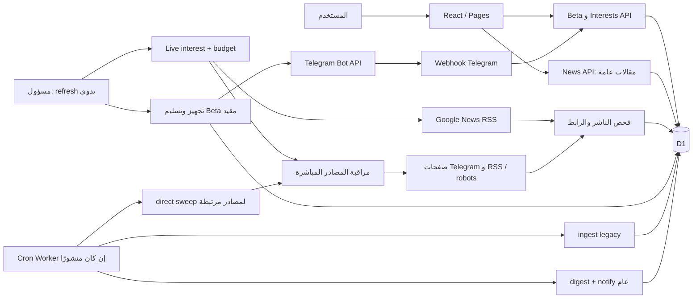

# DialSyria — تدقيق النظام الهندسي

تاريخ المراجعة: 25 نوفمبر 2026. النطاق: شجرة العمل المحلية في جذر المشروع، بما فيها الملفات غير الملتزم بها. المراجعة تحليل وتوثيق فقط؛ لم تتصل بخدمات حية أو Cloudflare أو D1 بعيدة، ولم تفحص واجهة في متصفح، ولم تغيّر الكود أو الإعدادات أو بيانات المستخدمين. الاختبارات المنفذة تعمل على بيانات وهمية وSQLite في الذاكرة.

**مفتاح الأدلة:** **Verified**: قراءة مباشرة للكود المحلي أو اختبار منفذ في هذه المراجعة؛ لا تعني أن الكود منشور. **Reported**: رواية في تقرير أقدم لم يُعَد اختبارها هنا. **Inferred**: أثر أو مخاطرة مستنتجة من الكود، وليست حادثة مثبتة. **Unknown**: يلزم دليل غير متاح. المراجع أدناه تستخدم مسارًا وسطرًا في هذه الشجرة. لا يتضمن التقرير قيم أسرار أو بيانات مستخدمين.

## 1. Executive Summary — الملخص التنفيذي

- **Verified:** يوجد تطبيق React وPages Functions وD1 مع مسارين مختلفين: نشرة RSS عامة قديمة، واكتشاف شخصي مباشر وTelegram-first Beta. التسجيل والمطابقة والتجهيز والتسليم اليدوي موصولة في الكود، ومغطاة باختبارات محاكاة (`src/App.tsx:40`, `functions/api/notify.ts:25`, `tests/beta-delivery.test.mjs:140`).
- **Verified:** لا يوجد مسار إرسال آلي مكتمل لمشتركي Beta الجدد: Cron يستدعي `/api/notify` بلا `beta_manual`، بينما `prepareNotifications` و`deliverPending` ترفضان Beta دون سياسة صريحة؛ فرع Beta اليدوي يتطلب مسؤولًا وقوائم سماح (`cron-worker/index.js:31`, `functions/api/notify.ts:25`, `functions/api/_notify.ts:210`, `functions/api/_notify.ts:423`). توجد مراقبة دورية لبعض المصادر المسجلة، وليست هذه مساوية للتسليم الآلي.
- **Verified:** حفظ اهتمام جديد لا ينشئ تلقائيًا ارتباطات مصادر؛ sweep يختار فقط من `direct_source_interests` ويتعامل مع اهتمام واحد في الدورة (`functions/api/beta.ts:85`, `functions/api/interests.ts:47`, `functions/api/direct.ts:13`). **Inferred:** مستخدم جديد قد يبقى بلا اكتشاف دوري حتى يبدأ أحد مسارات الاكتشاف التي تنشئ الروابط.
- **Verified:** اختبار هذه المراجعة: **105 نجحت، 0 فشلت** من مجموعة منتقاة؛ ستة اختبارات في ملف واحد استُبعدت لأنه يكتب ملفًا محليًا. نجح فحص TypeScript للواجهة والخلفية دون توليد. لم يُنفَّذ بناء Vite لأنه يكتب `dist`؛ ولم يُختبر Cloudflare أو Telegram فعليًا. التفاصيل في القسم 13.
- **Inferred:** يصلح الوضع لمراجعة تجربة ضيقة يديرها مشغّل بعد التحقق المنفصل، ولا توجد أدلة كافية لتعهّد بتغطية الأخبار السورية أو إطلاق Beta آلي متعدد المستخدمين. **Unknown:** النسخة والموارد المنشورة حاليًا؛ لم يتم اتصال حي.

## 2. Project Purpose & Scope — الهدف والنطاق

DialSyria يهدف إلى عرض أخبار سورية وتمكين المستخدم من متابعة اهتمامات طبيعية وتلقي تحديثات متحققة عبر Telegram؛ كما يحتفظ بنشرة أقدم حسب فئات ومواعيد وبريد/Telegram (`src/pages/Home.tsx:1`, `functions/api/_ingest.ts:16`, `functions/api/_notify.ts:199`). الواجهة العامة `/api/news` تعرض صفوف `articles` الحديثة بحسب وقت الجمع، وليست نتائج الاكتشاف الشخصي (`functions/api/news.ts:23`). **Verified بالكود؛ Unknown عن جودة النتائج الفعلية أو تغطيتها الحالية.**

## 3. Current Implementation Status — الحالة الفعلية

| المكوّن | الحالة والأدلة | حدود الاستنتاج |
|---|---|---|
| الموقع وCRUD | **Verified:** React، صفحات Home/Subscribe/Beta/Manage/Admin، وثلاثة اهتمامات لـBeta عبر الجلسة (`src/App.tsx:40`, `functions/api/interests.ts:40`) | لم يُختبر المتصفح أو النشر |
| Beta | **Verified:** تحدٍّ مرتبط بالمتصفح وTelegram، جلسة، قبول وإيقاف وإلغاء (`functions/api/beta.ts:34`, `functions/api/beta.ts:56`, `functions/api/beta.ts:97`) | لا إثبات لتكوين أو توفر الخدمة الحية |
| الاكتشاف | **Verified:** Google RSS، Brave اختياري في endpoints محمية، مراقبة مصادر عامة ونتائج محفوظة (`functions/api/_discovery.ts:132`, `functions/api/_direct.ts:54`) | **Reported:** اختبار سابق اكتشف ستة مواقع وصفر أحداث مباشرة من 15؛ إصدار ووقت مختلفان (`DISCOVERY_REPORT.md:413`) |
| التسليم | **Verified:** تحضير وإرسال مقيد ومراجعة ثانية وmock؛ Beta يدوي فقط (`functions/api/notify.ts:25`, `functions/api/_notify.ts:365`) | لا يعني وجود رسالة حية ناجحة في هذه المراجعة |
| المجدول | **Verified:** إعداد Worker وكل نصف ساعة/ساعة في المصدر (`cron-worker/wrangler.jsonc:5`) | **Unknown:** هل نُشر أو فُعّل وما ربطه الحالي |

**حالة Git قبل المراجعة:** الفرع المحلي `codex/foundation-personal-interests`، HEAD المختصر `da901db`، ومرجع `origin/codex/foundation-personal-interests` المحلي عند نفس الالتزام؛ هذا المرجع قديم محليًا وليس تحققًا من GitHub. مؤشر Git فارغ؛ 30 ملفًا متتبعًا معدّلًا و40 غير متتبع، بينها وحدات Beta والترحيلات 0009–0011 والاختبارات والتقارير والملفات المضغوطة و`opencode.jsonc`؛ `package-lock.json` معدّل سابقًا. لا يعني ذلك أن كل التغييرات من هذه المراجعة. **بعد إنشاء التقرير:** تحقق Git أظهر 30 ملفًا متتبعًا معدّلًا و41 غير متتبع و0 staged، والملف الإضافي هو `DIALSYRIA_SYSTEM_AUDIT.md`. لم يُجرَ fetch أو مقارنة بالنشر؛ `main` المحلي عند `dbfb521` لا يثبت حالة الإنتاج.

## 4. Architecture & Dependency Map — البنية المعمارية



**Verified:** Pages Functions في `functions/api`، bind باسم `DB` في `wrangler.toml:5`؛ Worker مستقل في `cron-worker/index.js:16`؛ React/Vite في `package.json:5`. نقاط API: `news/config` قراءة عامة؛ `subscribe/login/me` مسار البريد القديم؛ `beta/interests/interests/discover` جلسة أو مالك؛ `telegram` webhook؛ `admin/login/admin/subscribers` إدارة؛ `ingest/digest/discover/direct/notify` محمية إداريًا أو بسر Cron (`functions/api/direct.ts:5`, `functions/api/notify.ts:12`).

**Inferred:** الاعتمادات المركزية هي D1، وسلوك المصادر/Google، وTelegram وCloudflare؛ مسارا legacy وpersonalized يكرران أجزاء من الجمع والإرسال والتوثيق. حزمة React وVite وTypeScript وWrangler محددة في `package.json:20`؛ لا يوجد دليل محلي كافٍ أن اعتمادًا معينًا غير مستخدم، لذا لا أوصي بحذفه بلا تحليل حزمة.

**Staging مقابل الإنتاج:** `wrangler.toml:1` إعداد محلي باسم إنتاج وD1 منفصلة عن قالب staging في `wrangler.staging.example.json:1` الذي يحوي placeholders، لا إثبات إعدادات فعلية. Middleware يفحص اسم المضيف وmarker وflags (`functions/_middleware.ts:7`)؛ لا يستطيع إثبات UUID للـbinding وحده. `scripts/staging-preflight.mjs:6` محلي. ملف `STAGING_DB_PREFLIGHT.md:3` **Reported تاريخي** وقد لا يمثل الوضع الحالي. لا تؤخذ تقارير الإعداد كإثبات نشر أو migrations فعلية.

## 5. End-to-End User Journey — المسار الكامل

| # | الخطوة والمدخل → المخرج | المسؤول والدليل | الحالة والاختبار |
|---:|---|---|---|
| 1 | فتح الصفحة → أخبار عامة أو Beta | `src/App.tsx:40`, `functions/api/news.ts:14` | **Verified** كود؛ لا فحص بصري |
| 2 | الاهتمامات → challenge وcookie، ثم تأكيد خاص | `src/pages/Beta.tsx:20`, `functions/api/beta.ts:34`, `functions/api/_beta.ts:41` | **Verified mock:** `tests/beta-auth.test.mjs:19` |
| 3 | 1–3 نصوص أو CRUD → `subscriber_interests` | `functions/api/beta.ts:10`, `functions/api/interests.ts:40` | **Verified mock:** `tests/interests.test.mjs:27`; legacy يسمح حتى 10 |
| 4 | المستخدم الخاص في Telegram → ربط الهوية والجلسة | `functions/api/telegram.ts:29`, `functions/api/beta.ts:56` | **Verified mock:** عزل ومطابقة المرسل `tests/beta-auth.test.mjs:31` |
| 5 | `resume` صريح → status و`notifications_enabled_at` | `functions/api/beta.ts:97`, `functions/api/beta.ts:113` | **Verified mock:** `tests/beta-auth.test.mjs:58` |
| 6 | اهتمام → مصادر | `functions/api/_source_catalog.ts:35`, `functions/api/_direct.ts:54` | **Verified:** عند تشغيل live/discovery؛ حفظ الاهتمام وحده لا يستدعيهما |
| 7 | بحث أو صفحات عامة → نتائج/منشورات | `functions/api/_discovery.ts:132`, `functions/api/_direct.ts:73` | **Verified mock:** `tests/direct.test.mjs:27`؛ الوصول الحي **Unknown** هنا |
| 8 | robots، قناة/رابط/عنوان/تاريخ → provenance | `functions/api/_publisher.ts:40`, `functions/api/_direct.ts:98` | **Verified mock:** `tests/source-first.test.mjs:80`؛ ليس تدقيقًا لصدق الادعاء |
| 9 | نص الاهتمام والمحتوى → قبول/رفض وسبب | `functions/api/_discovery.ts:33`, `functions/api/_discovery.ts:55` | **Verified mock**؛ الدقة على المجتمع الفعلي غير مقاسة حاليًا |
| 10 | ناشر/تاريخ/هوية/opt-in وقائمة سماح | `functions/api/_notify.ts:151`, `functions/api/_notify.ts:168` | **Verified mock:** `tests/beta-delivery.test.mjs:32` |
| 11 | عناصر مؤهلة → `prepared` | `functions/api/_notify.ts:199`, `functions/api/_notify.ts:302` | **Verified mock**؛ قد يكون verified>0 وprepared=0 |
| 12 | طلب مسؤول `beta_manual` وdelivery مفعّل → Bot API | `functions/api/notify.ts:25`, `functions/api/_notify.ts:643` | **Verified code + mock**؛ لا دليل رسالة حقيقية هنا |
| 13 | مفتاح URL وحجز claim وتحديث حالة | `functions/api/_notify.ts:302`, `functions/api/_notify.ts:459` | **Verified mock**؛ ليس exactly-once |
| 14 | `failed`/claim قديم → محاولة عند استدعاء لاحق | `functions/api/_notify.ts:418` | Beta يحتاج مشغّل؛ Staging يسجل محاولة واحدة (`functions/api/notify.ts:37`) |

**الإجابة:** من الاكتشاف إلى تسليم Beta توجد سلسلة يدوية محمية ومختبرة بمحاكاة؛ **لا تعمل تلقائيًا من البداية إلى النهاية لـBeta الجديد في الكود المحلي**. لا يُستنتج من ذلك غياب أي وظيفة مجدولة للـlegacy أو لمراقبة المصادر الموجودة.

## 6. News Discovery Engine — تدقيق الاكتشاف

**Verified:** `generateQueries` يطبّع العربية ويستخرج مناطق ومرادفات ويولّد حتى أربعة استعلامات (`functions/api/_discovery.ts:15`, `functions/api/_discovery.ts:23`). `search` يستخدم Brave عند تمرير مفتاح صراحة وإلا Google News RSS لـ30 يومًا؛ Brave fallback إلى RSS (`functions/api/_discovery.ts:132`). في `runLiveInterest` لا يُمرر مفتاح Brave، لذا المسار الشخصي الافتراضي يستخدم Google حتى لو وُجد متغير في البيئة؛ endpoint الإدارة فقط يمرره عند `use_brave` (`functions/api/_live_interest.ts:80`, `functions/api/direct.ts:22`). لا نفترض الاشتراك أو كلفته أو تفعيله.

يستخرج `discoverDirectSources` مصادر من نتائج البحث ويربط المصدر بمفتاح الاهتمام؛ Google News فهرس أخبار ولا يضمن اكتشاف قنوات أو جميع المواقع (`functions/api/_direct.ts:14`, `functions/api/_direct.ts:54`). كتالوج ثابت ضيق يربط قناتي جامعة إدلب والوزارة وفئة سانا بحسب الاهتمام، ومواقع مرشحة معطلة (`functions/api/_source_catalog.ts:6`). ليس صحيحًا أن كل الكود ثابت المصادر، لكن **Inferred:** التغطية العملية للاهتمامات المدعومة تعتمد على المصادر المُعدّة مسبقًا وعلى Google في حالة غياب Brave. **Reported:** الجولة السابقة على 15 اهتمامًا وجدت ستة مواقع ولا قناة و0 من الأحداث المرجعية المباشرة؛ هذا قياس تاريخي على إصدار سابق وليس تجربة هذه المراجعة (`DISCOVERY_REPORT.md:415`).

القراءة: Telegram العام عبر `t.me/s`؛ يقص parser حتى 20 منشورًا ويطلب permalink للتحقق (`functions/api/_direct.ts:22`, `functions/api/_direct.ts:133`). مواقع الويب تُراقب عبر إضافة `/feed/` للمصدر/التصنيف (`functions/api/_direct.ts:97`)، وليس زاحف HTML عامًا. عند فشل البحث يمكن محاولة صفحة `before` واحدة لمصدر Telegram معروف، ضمن الميزانية، لا اكتشاف مصدر جديد (`functions/api/_live_interest.ts:129`, `functions/api/_direct.ts:103`). اتّباع redirects للناشر محدود وبنفس host عند حل Google؛ robots يفشل مغلقًا لعدم توفره وبعض الصيغ، والبحث الثانوي يجرب `/feed/` (`functions/api/_publisher.ts:47`, `functions/api/_secondary.ts:15`). لا تجاوز authentication.

**وقت وتقييد:** live الشخصي 18 ثانية و24 طلبًا و2.5 ثانية للطلب وجسمه (`functions/api/_live_budget.ts:14`)؛ اهتمام Beta يقسم الوقت بين حتى ثلاثة (`functions/api/notify.ts:43`). 429 يُسجل cooldown و`incomplete` (`functions/api/_live_interest.ts:104`, `functions/api/_direct.ts:88`). **Inferred:** D1 والمعالجة المتزامنة/الـlegacy sweep خارج هذه الضمانة؛ الطلب الكلي ليس مكفولًا بمهلة صلبة. تقارير `direct_runs` و`discovery_runs` تسجل دورات وأسبابًا، لكنها ليست مراقبة خارجية أو إنذارًا.

## 7. Relevance & Verification — المطابقة والتحقق

**Matching:** `evaluate` يوازن المجموعات بعتبة 0.34، يتحقق من الموقع وحد 30 يومًا عندما يوجد التاريخ (`functions/api/_discovery.ts:33`). `evaluateDirect` يضيف شروطًا محلية لمواضيع بعينها؛ كلمات عامة ولواصقها لا تُحتسب كموضوع (`functions/api/_discovery.ts:17`, `functions/api/_discovery.ts:55`). للاهتمام العام بالمؤسسة يوجد سياق ضيق لقناتين محددتين وفحص نشاط أكاديمي، ويُعاد التقييم قبل التجهيز والتسليم (`functions/api/_source_catalog.ts:24`, `functions/api/_notify.ts:277`). **Inferred:** القواعد المعجمية قد ترفض تعبيرات عربية أو صياغات لا تحتوي مفردات التخصص، وقد تقبل تداخلًا لفظيًا مضللًا؛ لا precision/recall حديثين مثبتين.

**Source verification:** صفحات الناشر يجب أن تقدم بيانات وعنوانًا مقارنًا؛ Telegram يجب أن يطابق معرف المنشور ونصه وتاريخه، وهوية القناة المعرّفة تُقارن بالعنوان المعلن (`functions/api/_publisher.ts:68`, `functions/api/_direct.ts:98`, `functions/api/_direct.ts:133`). القناتان تصفان نفسيهما بالجهة؛ لا يثبت ذلك اعتمادًا حكوميًا مستقلاً. `isPublisherVerified` يتطلب title_match وعدم تضارب (`functions/api/_notify.ts:178`). **Verified:** التحقق يثبت منشأ/تطابقًا وفق القاعدة، لا صحة الواقعة أو مصداقية الناشر. غياب التاريخ قد يقبل في الاكتشاف لكن يمنع تسليم Beta عبر `betaFresh`.

**Coverage ≠ Matching ≠ Verification:** فقد المصدر من الفهرس إخفاق تغطية، رفض نتيجة مناسبة إخفاق مطابقة، وتعذر إثبات الرابط إخفاق provenance. الأرقام السابقة لا تسمح بقياس الثلاثة مجددًا بعد التعديلات، وقياس عمر المقال في جولة قديمة ليس تأخر اكتشاف الخدمة (`DISCOVERY_REPORT.md:193`). لا توجد آلية تحقق وقائعي أو ضمان منع الأخبار المضللة.

## 8. Notification & Telegram Delivery — الإشعارات

**Verified:** `subscriberEligible` يستبعد الحالات المنتهية والملغاة/الموقفة؛ `betaDeliveryAllowed` يتطلب هوية Beta، opt-in، محادثة خاصة، ملكية فريدة وقائمتي الدعوة/الإرسال (`functions/api/_notify.ts:168`, `functions/api/_notify.ts:187`). `betaFresh` يتطلب نشرًا ورصدًا دقيقين بعد آخر تفعيل أو تعديل اهتمام، مع نافذة افتراضية 72 ساعة (`functions/api/_notify.ts:151`). إيقاف/إلغاء يفرغ opt-in (`functions/api/beta.ts:97`).

`verified > 0` يقيس نتائج مباشرة اجتازت تحقق الاكتشاف، بينما `prepared = 0` ممكن بسبب التوقيت قبل baseline، تاريخ مفقود/قديم، إعادة تقييم الصلة، المصدر/الملكية، أو تكرار URL سابق أو عدم الأهلية (`functions/api/_live_interest.ts:147`, `functions/api/_notify.ts:253`, `functions/api/_notify.ts:302`). أسباب الاستبعاد ليست مفصلة كلها في استجابة التحضير: لا يمكن منها وحدها تحديد السبب الدقيق لكل صفر.

الحالات `prepared`, `sending`, `sent`, `failed`, `rejected`: claim ذري وصفوف `sending` القديمة قابلة للاستعادة بعد عشر دقائق، والفشل يُعاد في تشغيل لاحق (`functions/api/_notify.ts:424`, `functions/api/_notify.ts:459`). قبل الإرسال يعاد التحقق من الأهلية والاهتمام والسجل (`functions/api/_notify.ts:474`). الإرسال مجمّع حتى ثلاثة عناصر في العادي ويتضمن العنوان/المصدر/التاريخ والرابط و`/more` (`functions/api/_notify.ts:99`)؛ staging يقيّد عنصرًا ومحاولة واحدة. **Inferred:** نجاح Telegram ثم انقطاع قبل `sent` قد يؤدي لتكرار عند استعادة claim خارج سياسة محاولة staging؛ لا idempotency موثقة من Bot API ولا exactly-once. **Verified:** `failed` لا يميز أسبابًا مؤقتة/دائمة أو Retry-After شاملًا للرسائل؛ لا backoff/عداد محاولات ظاهر في هذه الدالة. `/more` يقيّد البحث بصاحب السجل (`functions/api/telegram.ts:48`, `functions/api/_notify.ts:616`).

## 9. Database & Migrations — البيانات

المخطط المحلي = `schema.sql` ثم ملفات `migrations/0001` إلى `0011`؛ ليس دليلًا على أن أي قاعدة بعيدة عند هذه النسخة. الجداول الـ23 الظاهرة في SQL، دون جداول تشغيل D1 الداخلية:

| المجموعة | الجداول والوظيفة | مفاتيح/مراجع |
|---|---|---|
| legacy | `subscribers`, `subscriber_topics`, `articles`, `ingestion_runs`, `rate_limits`, `digests` | بريد ورابط article فريدان؛ `schema.sql:1`, `schema.sql:23` |
| discovery | `discovery_runs`, `discovery_sources`, `discovery_source_interests`, `discovery_items`, `discovery_item_interests` | URL و`title_key` فريدان؛ ربط بالاهتمام؛ `migrations/0001_discovery.sql:2`؛ provenance في `0002` |
| direct | `direct_sources`, `direct_source_interests`, `direct_items`, `direct_runs`, `direct_provider_backoff` | URL مصدر ومادة فريد؛ `migrations/0003_direct_sources.sql:1`؛ التحقق في `0009` |
| مستخدم | `subscriber_interests`, `telegram_link_tokens` | uniqueness للمالك/النص، مفاتيح ملكية؛ `migrations/0004_subscriber_interests.sql:2`, `migrations/0007_telegram_link_tokens.sql:3` |
| إرسال | `notifications`, `beta_notification_keys` | owner/item فريد وURL canonical لكل Beta؛ `migrations/0006_notifications.sql:3`, `migrations/0011_beta_delivery.sql:5` |
| Beta | `beta_challenges`, `beta_identities`, `beta_sessions` | hash للتحدي والجلسة، chat وsubscriber فريدان، فهارس expiry (`migrations/0010_beta_auth.sql:2`) |

**Verified:** الترحيلات إضافية وتهدف للحفاظ على البيانات القديمة، لكن `ALTER TABLE ADD COLUMN` غير ذاتية التكرار إذا نفذت خارج آلية تتبع migrations (`migrations/0008_notification_delivery_claim.sql:3`). marker staging منفصل يُنشأ في `scripts/staging-prepare.mjs:17`، وليس migration 0011. توجد اختبارات ترحيل على بيانات SQLite معزولة ضمن المجموعة المنفذة (`tests/source-first.test.mjs:167`)، ولا يثبت ذلك نجاح ترحيل D1 حقيقية أو جميع سيناريوهات البيانات القديمة.

**Inferred:** علاقات عدة جداول direct/discovery مفاتيح نصية دون FK صريح (`migrations/0003_direct_sources.sql:1`) قد تترك ارتباطات يتيمة إن حُذفت مصادر أو اهتمامات. `title_key` الفريد عالميًا قد يدمج خبرين مختلفين لهما العنوان نفسه (`migrations/0001_discovery.sql:5`, `functions/api/_discovery.ts:192`). batch SQLite التجريبي ينفذ عبارات تسلسليًا (`scripts/discovery-runtime.mjs:65`) ولا يثبت الذرية والتزامن الفعليين في D1. `SELECT` كل URL للإشعارات وتحضير جميع المشتركين، وsweep عبر `last_checked_at` دون فهرس ظاهر قد يزداد كلفة (`functions/api/_notify.ts:302`, `functions/api/_notify.ts:527`, `functions/api/direct.ts:13`). يلزم EXPLAIN وحمل حقيقي قبل تقدير أثر أو فهارس. لا توجد هنا خطة backup/restore أو retention مثبتة للبيئة المنشورة.

## 10. Frontend & UX — الواجهة

**Verified من الكود:** الصفحة Beta تطلب حتى ثلاثة اهتمامات، تدير challenge، poll كل ثلاث ثوانٍ، وتعرض اتصال Telegram والاشتراك والإيقاف/الإلغاء والاهتمامات وآخر تنبيه (`src/pages/Beta.tsx:20`, `src/pages/Beta.tsx:55`). `/manage` يوجّه إلى Beta بدون token وإلى legacy معه (`src/App.tsx:42`). `Manage` يدعم اختبار الاهتمام للمسار القديم (`src/pages/Manage.tsx:214`)؛ لا يظهر زر مكافئ في صفحة Beta. الواجهة تعرض أن التغطية محدودة (`src/pages/Beta.tsx:38`) وتذكر أن إلغاء الاشتراك لا يحذف البيانات (`src/pages/Beta.tsx:68`).

**Verified:** RTL عبر `dir` وأنماط مرنة وmedia queries، labels و`role=status/alert` موجودة في أجزاء (`src/pages/Beta.tsx:34`, `src/styles.css:56`). **Inferred:** إشعار خطأ عام في بعض العمليات وغياب تشخيص مفصل لـprepared=0 قد يصعّبان فهم الصمت؛ البحث الحي ليس ظاهرًا كوظيفة Beta مستقلة. **Unknown:** قابلية الوصول الفعلية، التباين، لوحة المفاتيح، قارئ الشاشة، الهاتف، النقل بين الشاشات، وحالات الخطأ في متصفح. لا نتائج screenshots أو Lighthouse أو اختبارات بصرية في هذه المراجعة.

## 11. Security & Privacy — الأمان والخصوصية

- **Verified:** جلسات Beta تخزن hash، cookies `HttpOnly; SameSite=Strict` و`Secure` عند HTTPS، وتتحقق من Origin للعمليات التي تعدّل البيانات (`functions/api/_beta.ts:5`, `functions/api/_beta.ts:12`, `functions/api/_beta.ts:21`). الاهتمامات تُستعلم بمالك الجلسة/رمز الإدارة وبـbind (`functions/api/interests.ts:8`, `functions/api/interests.ts:61`). اختبارات الحسابين وCSRF محاكاة، لا تدقيق اختراق شامل (`tests/beta-auth.test.mjs:45`).
- **Verified:** webhook يفحص secret ويرفض غير الخاص أو اختلاف المرسل (`functions/api/telegram.ts:12`, `functions/api/telegram.ts:29`)، والمشرف/Cron محميان (`functions/api/notify.ts:13`). توجد حدود على بدء Beta واكتشاف الاهتمام (`functions/api/beta.ts:35`, `functions/api/interests/discover.ts:20`).
- **Verified risk:** legacy يمرر magic token في URL ويخزنه في subscriber؛ Admin يخزن token في `localStorage` (`src/lib/api.ts:60`, `functions/api/login.ts:18`, `src/pages/Admin.tsx:12`). **Inferred:** قابلية تسرب عبر history/logs أو XSS؛ لم يُثبت استغلال. Staging يمنع مسارات ورموز legacy عبر middleware (`functions/_middleware.ts:14`). لا تظهر سياسة CSP في `public/_headers:1`؛ عدم وجودها ليس بمفرده إثبات XSS.
- **Inferred:** `safeUrl` يمنع عناوين رقمية وlocalhost وبعض اللاحقات لكنه لا يثبت فحص DNS بعد الحل لكل طلب (`functions/api/_publisher.ts:4`)؛ احتمال SSRF/DNS rebinding يعتمد على حماية منصة Cloudflare وطريقة الوصول، لم يُختبر ولا يُعلن استغلال. قيّد الوصول والعناوين وأعد اختبارًا معزولًا قبل التوسع.
- **Verified:** النصوص والأخبار والاهتمامات ومعرف المحادثة وحالات التسليم تُخزّن؛ نص الاهتمام يُرسل ضمن استعلام بحث (`functions/api/_discovery.ts:138`). الإلغاء يغير الحالة ولا يحذف البيانات (`functions/api/beta.ts:97`, `src/pages/Beta.tsx:68`). **Unknown:** موافقة الخصوصية الكافية، مدة الاحتفاظ، الحذف التشغيلي ونسخ النسخ الاحتياطية. لم تُفحص قيم الأسرار أو إعدادات Cloudflare الفعلية؛ ليس هذا فحص تسرب أسرار شاملًا.

## 12. Scheduling & Operations — التشغيل

**Verified من المصدر:** Cron نصف ساعة يستدعي ingest وdirect sweep؛ الساعة `:07` يستدعي digest وnotify (`cron-worker/index.js:21`). `direct sweep` يراقب اهتمامًا مرتبطًا واحدًا، ويبحث اكتشافًا إضافيًا بعد 24 ساعة عند وجوده (`functions/api/direct.ts:11`). **Inferred:** الحد النظري 48 اهتمامًا في اليوم إذا نجحت جميع دورات نصف الساعة، قبل حساب المدد والأخطاء؛ لا SLA لآلاف الاهتمامات. قد ينتهي sweep دون عمل إذا لم توجد روابط مصدر. Beta لا يرسل آليًا كما في القسم 5. إعداد cron المحلي يحدد نطاقًا إنتاجيًا، وليس دليلًا أن trigger ناشط (`cron-worker/wrangler.jsonc:5`).

**Verified:** logs لـHTTP failure، تقارير تشغيل D1 وعدادات بعض المراحل (`cron-worker/index.js:7`, `functions/api/_direct.ts:50`, `functions/api/notify.ts:41`). لا توجد أدلة على dashboards أو تنبيهات أو trace موزع أو قياسات تكلفة حية. **Inferred:** scan والتكرار وطلبات مصادر كثيرة قد تصطدم بالحصص؛ لا نقدّر الرسوم أو خطة الحساب دون تحقق. سياسة Google cooldown يمكن أن توقف البحث العام بعد 429 من ناشر أيضًا (`functions/api/_live_interest.ts:104`).

## 13. Tests & Evidence — الاختبارات والأدلة

| المجال | ما اختُبر في هذه المراجعة | ما لم يثبت |
|---|---|---|
| Beta/auth/ملكية | `tests/beta-auth.test.mjs` عزل مستخدمين وOrigin وchallenge | Telegram أو متصفح أو D1 حقيقية |
| discovery/relevance | `tests/discovery.test.mjs`, `tests/source-first.test.mjs` استعلامات وقواعد وهوية وروابط | قياس تغطية/precision على أخبار حقيقية حديثة |
| أخطاء الشبكة | `tests/live-budget.test.mjs` مهلة وbody و429 وrobots وfallback | Cloudflare wall time وقيود مزود فعلي |
| إرسال وتزامن | `tests/beta-delivery.test.mjs`, `tests/notifications.test.mjs` opt-in ورفض ومطالبة وإعادة محاولة | ذرية D1 الفعلية، crash-after-send، تجربة بوت حقيقية |
| Cron | `tests/scheduled-delivery.test.mjs` calls وهمية | تفعيل Worker وbinding والوقت الحقيقي |
| staging | `tests/staging-pilot.test.mjs` middleware/قوائم بـenv مصطنعة | إعدادات أو موارد Cloudflare الفعلية |
| E2E | `tests/e2e.test.mjs:65` و`tests/beta-delivery.test.mjs:140` مسار متكامل مُحاكى | E2E حقيقي عبر المتصفح وTelegram والمزود |
| legacy security task16 | الملف موجود | **لم يُنفذ** في هذه المراجعة؛ يكتب `.wrangler/discovery/task16-digest.mjs` (`tests/task16-security.test.mjs:13`) |

الأمر المنفذ في PowerShell اختار كل `tests/*.test.mjs` ما عدا `task16-security.test.mjs` وشغّل `node --test @dialTests`: **105/105 نجحت، 0 فشل**. اختبارات SQLite تطبق schema ومigrations على `:memory:` فقط (`scripts/discovery-runtime.mjs:50`)؛ لا D1 بعيدة ولا رسائل حقيقية. أوامر `node node_modules/typescript/bin/tsc --noEmit` و`node node_modules/typescript/bin/tsc -p tsconfig.backend.json --noEmit` نجحت. فحص الخلفية استخدم `worker-configuration.d.ts` الموجود ولم يتحقق من مطابقته للـbinding البعيد. لم نشغّل `npm test` كاملة بسبب ملف task16، ولا `npm run build` لأنه يكتب `dist`، ولا `npm run typecheck:backend` لأنه يعيد توليد تعريفات Wrangler (`package.json:11`). نجاح النوعين لا يثبت نجاح حزمة Vite أو نشرها.

حالة Git عند البداية: 30 tracked معدلة و40 untracked و0 staged، على `da901db`. فحص النهاية بعد إنشاء التقرير: 30 tracked معدلة و41 untracked و0 staged، وظهر `DIALSYRIA_SYSTEM_AUDIT.md` كملف إضافي غير متتبع؛ لا commit أو push. الملفات السابقة بما فيها `package-lock.json` و`opencode.jsonc` بقيت خارج أي تعديل مقصود بهذه المراجعة.

### لقطة Git التفصيلية قبل المراجعة

```text
 M .gitignore
 M DISCOVERY_REPORT.md
 M README.md
 M functions/api/_digest.ts
 M functions/api/_direct.ts
 M functions/api/_discovery.ts
 M functions/api/_lib.ts
 M functions/api/_notify.ts
 M functions/api/_publisher.ts
 M functions/api/_secondary.ts
 M functions/api/admin/subscribers.ts
 M functions/api/interests.ts
 M functions/api/interests/discover.ts
 M functions/api/notify.ts
 M functions/api/telegram.ts
 M functions/api/telegram/link.ts
 M package-lock.json
 M package.json
 M scripts/discovery-runtime.mjs
 M src/App.tsx
 M src/lib/api.ts
 M src/lib/i18n.ts
 M src/pages/Home.tsx
 M src/pages/Manage.tsx
 M src/styles.css
 M tests/direct.test.mjs
 M tests/e2e.test.mjs
 M tests/notifications.test.mjs
 M tests/telegram-details.test.mjs
 M tests/telegram-link.test.mjs
?? CODEX_DISCOVERY_FALLBACK.md
?? CODEX_DISCOVERY_HANDOFF.md
?? DialSyria-Codex-review.zip
?? DialSyria-discovery-review.zip
?? DialSyria-final-review-files.zip
?? STAGING_CHECKPOINT.json
?? STAGING_DB_PREFLIGHT.md
?? STAGING_PILOT_REPORT.md
?? functions/_middleware.ts
?? functions/api/_beta.ts
?? functions/api/_live_budget.ts
?? functions/api/_live_interest.ts
?? functions/api/_source_catalog.ts
?? functions/api/beta.ts
?? migrations/0009_direct_verification.sql
?? migrations/0010_beta_auth.sql
?? migrations/0011_beta_delivery.sql
?? opencode.jsonc
?? scripts/beta-local-smoke.mjs
?? scripts/demo.mjs
?? scripts/historical-source-check.mjs
?? scripts/live-interest-smoke.mjs
?? scripts/local-beta-onboarding.mjs
?? scripts/local-interest-browser.mjs
?? scripts/source-coverage-check.mjs
?? scripts/staging-checkpoint.mjs
?? scripts/staging-preflight.mjs
?? scripts/staging-prepare.mjs
?? src/pages/Beta.tsx
?? tests/beta-auth.test.mjs
?? tests/beta-delivery.test.mjs
?? tests/demo.test.mjs
?? tests/live-budget.test.mjs
?? tests/live-interest.test.mjs
?? tests/publisher-verification.test.mjs
?? tests/source-first.test.mjs
?? tests/staging-pilot.test.mjs
?? tests/subscription-eligibility.test.mjs
?? tests/task16-security.test.mjs
?? wrangler.staging.example.json
```

بعد المراجعة بقيت القائمة أعلاه، مع السطر الإضافي الوحيد: `?? DIALSYRIA_SYSTEM_AUDIT.md`. لم يُضف أي ملف إلى index.

## 14. Verified Issues & Risks — العيوب والمخاطر

الأولوية مرتبطة بمعيار المنتج: P0 مانع ادعاء Beta آلي آمن، لا تعني استحالة تجربة يديرها مشغّل بعد إذن وفحص منفصل. كل إعادة إنتاج أدناه محلية/افتراضية ولا تتطلب إرسالًا حقيقيًا.

### P0-1 — Beta لا يكتشف ويسلّم تلقائيًا من تسجيل جديد

**Verified code:** `functions/api/beta.ts:85` يحفظ الاهتمام دون ربط مصدر، و`functions/api/direct.ts:13` يبدأ من مصادر مرتبطة، وCron يرسل notify بلا `beta_manual` (`cron-worker/index.js:31`)، فتمنع سياسة Beta التسليم دون سياق صريح (`functions/api/_notify.ts:210`, `functions/api/_notify.ts:423`). **إعادة الإنتاج:** في SQLite معزولة أنشئ Beta مع اهتمام فعّال دون `direct_source_interests`؛ نفّذ sweep ثم notify المجدولين بمستقبل وهمي؛ لا يتم bootstrap أو تسليم Beta. **الأثر:** تفعيل المستخدم قد ينتهي بصمت دائم. **السبب:** المساران موجهان عمدًا لتهيئة ومشغّل يدويين؛ ليس دليلًا على إعداد حي. **المقترح:** workflow مراقبة مؤهل/محدود ومصرّح به للمشتركين أو توضيح شرط التدخل اليدوي في pilot. **القبول:** اختباران معزولان ثم تجربة مُصرح بها لمستخدمين منفصلين تثبتان onboarding → مصدر موثوق → نشر جديد بعد baseline → رسالة وحيدة، وصمت غير المؤهل. **التبعيات:** P1-2 وP1-3 والتحكم التشغيلي.

### P1-1 — `/news` القديم لا يطبق كل أهلية Beta/الانتهاء

**Verified code:** خارج staging، يستعلم `/news` عن status و`last_digest_at` فقط ثم يستخدم النشرة العامة (`functions/api/telegram.ts:67`, `functions/api/telegram.ts:100`)، بينما المجدول يستثني `created_beta=1` (`functions/api/_digest.ts:230`) والمسار الشخصي يتحقق من انتهاء الأهلية (`functions/api/_notify.ts:187`). **إعادة الإنتاج:** webhook وهمي خاص لمشترك `active` انتهت `expires_at`، أو Beta active، مع مقالات legacy؛ راقب transport الوهمي. **الأثر:** استجابة نشرة عامة بطلب المستخدم رغم الفصل المقصود أو بعد انتهاء الصلاحية؛ ليس إرسالًا تلقائيًا أو دليلًا على حادث حي. **السبب:** handler منفصل لا يستدعي سياسة الأهلية المشتركة. **الإصلاح المقترح:** توحيد أهلية `/news` واستثناء Beta أو تخصيص سلوكه. **القبول:** اختبارات منتهٍ وBeta وموقوف ومحادثة خاطئة تثبت عدم إرسال digest القديم. **التبعيات:** سياسة المنتج للطلب اليدوي.

### P1-2 — تغطية مصادر غير مثبتة وBrave غير موصول بالمسار الشخصي

**Verified:** `functions/api/_live_interest.ts:80` لا يمرر مفتاحًا؛ البديل بعد فشل Google صفحة قناة معروفة (`functions/api/_live_interest.ts:129`)، والمرشحان المؤسسيان ثابتان في `functions/api/_source_catalog.ts:6`. **Reported:** ستة مواقع و0 أحداث من 15 في تجربة تاريخية (`DISCOVERY_REPORT.md:417`). **إعادة الإنتاج:** mocks لـGoogle فارغ/429 بلا مصادر مرتبطة؛ لا قناة تُكتشف من لا شيء. **الأثر:** صمت عن أحداث حقيقية، خصوصًا خارج المؤسستين. **السبب:** مصدر بحث محدود وfallback يعيد مراقبة معروف. **المقترح:** خطة مصادر مشروعة قابلة للقياس وتجربة مزود مستقل بعد موافقة التكلفة، دون خفض التحقق. **القبول:** benchmark زمني مستقل متنوع معلن المصادر والمفقود والدقة والتكلفة، دون إعطاء الروابط للمحرك. **التبعيات:** حق الوصول واختيار المزود.

### P1-3 — التحقق من المنشأ لا يتحقق من صحة الادعاء أو هوية مؤسسة مستقلة

**Verified:** المطابقة تعتمد metadata والعنوان وrobots أو إعلان عنوان القناة (`functions/api/_publisher.ts:68`, `functions/api/_direct.ts:98`, `functions/api/_notify.ts:178`). **إعادة الإنتاج:** مصدر وهمي يطابق شروط العنوان وينشر ادعاءً كاذبًا؛ المنظومة لا تمتلك مرجع تحقق حقائق. **الأثر:** عبارة «مؤكد» قد تُفهم بأنها صدق الخبر؛ القناة self-declared. **المقترح:** وسم دقيق للمنشأ، سجل هوية مؤسسية مدقق وآلية مراجعة بشرية أو مصادر مستقلة للأخبار الحساسة. **القبول:** فصل source verified عن fact checked في API/واجهة وتغطية الاختبارات للأسماء المنتحلة. **التبعيات:** P1-2 وسياسة التحرير.

### P1-4 — الإرسال غير exactly-once والتجربة تحتفظ بمحاولة واحدة

**Verified:** إرسال ثم تحديث `sent` (`functions/api/_notify.ts:507`)، استعادة claim بعد عشر دقائق (`functions/api/_notify.ts:424`)؛ staging يحجز محاولة حتى عند غموض النتيجة (`functions/api/notify.ts:37`). **إعادة الإنتاج:** transport وهمي ينجح ثم محاكاة توقف قبل حفظ الحالة؛ افحص استعادة lease. **الأثر:** خطر تكرار خارج staging أو توقف staging بعد timeout. **السبب:** لا معاملة ذرية بين Bot API وD1. **المقترح:** سجل محاولات/outbox وعمليات تسوية مرئية، وحدود retry وتمييز failure؛ لا وعد exactly-once دون خاصية من المزود. **القبول:** اختبارات crash/timeout متوازية وقرار تشغيلي موثق لكل حالة. **التبعيات:** P0-1.

### P1-5 — معلومات نشر وبيئات غير مثبتة

**Verified:** local `wrangler.toml:5` وtemplate مختلف (`wrangler.staging.example.json:5`) وmarker لا يكشف UUID الحقيقي للـbinding (`functions/_middleware.ts:3`). Git remote-tracking محلي لا يعني نسخة التطبيق المنشورة. **إعادة الإنتاج:** مقارنة offline بين القالب والـconfig فقط. **الأثر:** نشر أو migration على بيئة غير مقصودة إن استُخدم الملف الخطأ. **المقترح:** preflight مع مراجعة هوية account وbinding وmigration ونسخة منشورة وbackup read-only بعد إذن. **القبول:** سجل مقارنة مستقل قبل كل تغيير. **التبعيات:** وصول وموافقة منفصلان؛ لا دليل على خطأ binding حالي.

### P2-1 — قياس ومراقبة أسباب الصمت محدودة

**Verified:** `refreshStatus` يلخص verified/errors (`functions/api/notify.ts:41`)؛ `prepareNotifications` يستخدم `continue` لأسباب عدة دون تقرير سبب لكل مرشح (`functions/api/_notify.ts:253`). **إعادة الإنتاج:** عنصر verified بتاريخ مفقود ثم prepare؛ النتيجة صفر دون سبب تفصيلي. **الأثر:** صعوبة تمييز لا خبر عن فشل. **المقترح:** عدادات أسباب مُجمّعة لا تكشف اهتمامات شخصية، وربط دورات بمقاييس وقت/حصص. **القبول:** اختبارات لكل سبب وإظهار incomplete بوضوح. **التبعيات:** سياسة الخصوصية.

### P2-2 — التوسع واحتفاظ البيانات غير مثبتين

**Verified:** حد اهتمام واحد لكل sweep، استعلامات متزايدة في `functions/api/direct.ts:13` و`functions/api/_notify.ts:302`; إلغاء لا يحذف (`src/pages/Beta.tsx:68`). **إعادة الإنتاج:** تحليل query plan في قاعدة اختبار مع مجموعات اصطناعية، وليس إنتاج. **الأثر:** تأخر وتكلفة محتملان واحتفاظ غير محدد؛ لا قياس حالي. **المقترح:** اختبارات حمل، pagination/fair scheduling، فهارس حسب EXPLAIN، وسياسة retention/hard deletion وrestore. **القبول:** أهداف قياس مُعتمدة وحذف شامل تم اختباره في قاعدة معزولة. **التبعيات:** تحديد حجم وSLO.

### P2-3 — تعرض tokens القديمة ومخاطر URL/DNS

**Verified:** legacy URL token وadmin localStorage (`src/lib/api.ts:60`, `src/pages/Admin.tsx:12`)؛ `safeUrl` فلتر نصي (`functions/api/_publisher.ts:4`). **إعادة الإنتاج:** فحص الرابط/التخزين وفحوص DNS اصطناعية دون شبكة حية. **الأثر:** احتمال تسرب/SSRF إذا تحققت شروط إضافية؛ لا استغلال مثبت. **المقترح:** استبدال legacy بجلسات مختصرة، CSP ومراجعة DNS/egress عبر Cloudflare. **القبول:** اختبارات automated وthreat model تحقّق المنصة. **التبعيات:** دعم الحسابات القديمة.

## 15. Readiness Scorecard — تقييم الجاهزية

الدرجات تقدير هندسي **Inferred** على مقياس 0–10: 0 غائب، 5 كود واختبارات جزئية دون دليل تشغيل، 8 تشغيل حي متكرر ومراقب، 10 دليل إنتاج/حمل/استرداد. لا يُرفع التقدير لوجود كود وحده.

| المحور | /10 | الأدلة | النواقص |
|---|---:|---|---|
| اكتمال الوظائف | 5 | مسار يدوي ومحاكاة (`functions/api/notify.ts:25`) | bootstrap وتسليم Beta آليان |
| موثوقية الاكتشاف | 3 | مصادر محدودة وfallback (`functions/api/_live_interest.ts:129`) | تغطية حية معاصرة واستقلال بحث |
| دقة المطابقة | 4 | قواعد واختبارات (`functions/api/_discovery.ts:33`) | benchmark precision/recall حديث |
| الإشعارات | 4 | حجز وإعادة تحقق (`functions/api/_notify.ts:459`) | تكامل حي وambiguous sends |
| الأمان والخصوصية | 5 | جلسة وموافقة (`functions/api/_beta.ts:12`) | legacy URL وretention واختبار أمني حي |
| قاعدة البيانات | 5 | migrations وقيود (`migrations/0011_beta_delivery.sql:5`) | إثبات D1 وbackup وحمل |
| الاختبارات والجودة | 6 | 105 ناجحة محاكاة | ستة مستبعدة، لا E2E حي أو UI |
| تجربة المستخدم | 4 | وظائف وحالات في `src/pages/Beta.tsx:35` | وصولية/هاتف/اختبار قابلية استخدام |
| التشغيل الآلي | 2 | cron legacy/sweep في المصدر | Beta غير مكتمل آليًا، الرصد مجهول |
| التوسع | 2 | sweep محدود وموازنات | قياس حمل/SLO/fair queue |

## 16. Prioritized Roadmap — خارطة التنفيذ

1. **Beta مغلق لمستخدم واحد:** دخول: تحديد نسخة وstaging وDB وبوت منفصل، مراجعة P1-1، opt-in وقائمة سماح، تشغيل يدوي واضح وبلا cron غير مصرّح به. خروج: تجربة واحدة مُصرّح بها مع رابط حقيقي وموعد بعد baseline، وإثبات عدم إرسال عند عدم الأهلية، وحفظ دليل رسالة/حالة دون كشف بيانات. المخاطر: timeout وتغطية محدودة وP1-4.
2. **Beta محدود لعدة مستخدمين:** دخول: P0-1 أو بروتوكول تشغيل يدوي معلن، معالجة retries والتسوية وP1-2/P1-3، اختبار هوية وعزل وإلغاء. خروج: تجربتان أو أكثر باهتمامات مختلفة، قياس false positives والمفقود و429 والتداخل والسجلات، واختبار تعطيل إرسال. المخاطر: أحجام المصادر واللغة.
3. **Beta عام:** دخول: مصدر اكتشاف متنوع وقانوني، فحص تكلفة وخصوصية، سياسة حقيقة/منشأ، monitoring وincident/retention، اختبار ضغط واسترداد. خروج: أهداف تغطية ودقة وزمن وموثوقية محددة ومقاسة، وإغلاق مخاطر الأمن ذات الأولوية. لا يعني نجاح mocks اعتمادًا تلقائيًا.
4. **إنتاج أولي:** دخول: مراجعة معمارية queue/outbox والحدود، عزل بيئات مثبت، نسخ واستعادة وتمارين انقطاع ومرونة provider، جاهزية تشغيل ودعم وحذف. خروج: اختبارات قبول مستقلة ومراقبة فعلية بعد تفويض. لا تقدير زمني دون نطاق وموارد.

## 17. Known Unknowns — معلومات غير مؤكدة

- **Unknown:** أي commit أو تغييرات منشورة في Staging/Production، حالة Pages/D1/bindings/migrations وcron وwebhook والأسرار؛ لم يُجر اتصال حي. التقارير السابقة متعارضة زمنيًا ولا تُحسم محليًا (`STAGING_PILOT_REPORT.md:5`, `STAGING_DB_PREFLIGHT.md:3`).
- **Unknown:** قدرة Google/Brave ومواقع سوريا وصفحات Telegram اليوم، أداء `before`، ملكية القنوات، ودقة النتائج بعد تعديلات الشجرة. النتائج السابقة **Reported** وليست إعادة قياس (`DISCOVERY_REPORT.md:543`).
- **Unknown:** نتائج UX الفعلية على الهاتف والوصولية، دعم الاستعادة، قياسات latency وحصص/تكلفة، وسياسات الاحتفاظ والحذف الفعلية.
- **Unknown:** حالة الاعتماديات الأمنية وإصدارها على النشر؛ لم تُجرِ المراجعة فحصًا شبكيًا للثغرات ولا بحثًا شاملًا عن أسرار.

## 18. Final Engineering Verdict — القرار الهندسي النهائي

**أ. ما يعمل اليوم؟** محليًا وبالاختبارات الوهمية: التسجيل والهوية والاهتمامات، مراقبة وتحقيق المصادر، مطابقة وتجهيز وتسليم عبر transport وهمي، حراس التكرار والأهلية. تقرير هذا التدقيق لا يثبت تشغيل هذه المزايا في الخدمة المنشورة.

**ب. ما يبدو مكتملًا ولم يُختبر حقيقيًا هنا؟** التكامل الشامل مع Cloudflare D1/Pages وcron وBot API ومصادر الأخبار وبحث Brave، والتجربة البصرية وقياسات التغطية. بعض التقارير القديمة تصف اختبارات حية تاريخية؛ لم نعد تنفيذها.

**ج. ما يمنع Beta؟** لادعاء Beta آلي: P0-1. لتجربة يديرها مشغّل: إثبات النسخة والعزل والصلاحيات وP1-1 وسلامة الرسالة والمصدر وتوقعات التغطية ومخاطر retry؛ لا ينبغي افتراض أن كل ذلك تم.

**د. أهم ثلاث أولويات:** (1) وصل تهيئة الاهتمام والتشغيل للمستخدم المؤهل مع خيار الأمان/التحكم؛ لأنه يعالج الصمت. (2) قياس وتحسين التغطية من مصادر مشروعة مع فصل دقة المطابقة والتحقق؛ لأنه يعالج غياب الأخبار. (3) توحيد أهلية `/news` ومراجعة retry/هوية البيئات؛ لأنها تحمي سلوك المستخدم وصحة الإرسال. الأدلة: P0-1 وP1-1 وP1-2 وP1-4 وP1-5.

**هـ. ماذا يفعل المستخدم الآن في المنشور؟** **Unknown.** لا اتصال أو دليل على hash النشر أو إعداداته في هذه المراجعة. يمكن وصف ما يسمح به الكود المحلي فقط، لا تأكيد حالة الموقع المنشور.

**و. المعمارية؟** الاستمرار على Cloudflare/TypeScript مناسب مبدئيًا لتجربة صغيرة؛ يُوصى بإعادة هيكلة جزئية محدودة لجدولة العمل، attribution والتشخيص وoutbox بعد قياس الحاجة، لا إعادة كتابة شاملة. هذا **Inferred** ولا يثبت ملاءمة Cloudflare لحجم غير مقاس.

**ز. الاختبار النهائي:** بعد موافقة منفصلة وفي staging معزول وبوتين/مستخدمين خاصين مُدرجين، سجل اهتمامين طبيعيين، فعّل أحدهما، راقب ناشرًا معروف الهوية وانشر/اختر تحديثًا حقيقيًا جديدًا بعد baseline، أثبت اكتشافه ورابطه وتاريخه ومطابقته وتجهيزه ثم رسالة وحيدة للمالك الصحيح، وصمت الآخر/الموقوف والقديم وغير الموثق؛ كرر مع 429 وtimeout وإعادة التشغيل والتكرار، وقارن بعينة مرجعية مستقلة. يتطلب تنفيذ أي إرسال حقيقي إذنًا مستقلًا.
